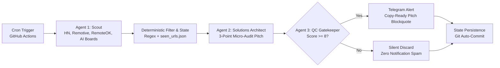

# 🎯 RiyanSniperBot (`sniper-agent`): Autonomous B2B Freelance & Micro-Audit Pipeline

[](https://github.com/riyankhamdani/sniper-agent/actions)
[](https://www.python.org/downloads/)

An autonomous, serverless outbound sniper that scrapes global B2B contracts, fractional DevOps/SRE gigs, and AI infrastructure tasks, then generates **tailored 3-point technical micro-audit pitches** ready to copy-paste—delivered to Telegram only when opportunities pass strict quality gates.

Designed with deterministic regex pre-filtering, a 3-agent AI relay (**Scout → Solutions Architect → QC Gatekeeper**), and zero-maintenance serverless execution.

---

## 🏗️ Multi-Agent Architecture & Pipeline Flow



---

## 🎯 Key Engineering Highlights

- **Multi-Source Contract Ingestion (Agent 1 — Scout):** Aggregates live freelance/contract threads from Hacker News (`Who is hiring?` / `Seeking freelancer?` via Algolia API), Remotive, RemoteOK, and Greenhouse AI evaluation boards (Turing, Scale AI).
- **Deterministic Pre-Filtering & Geo-Lock Removal:** Strips out disguised full-time W2 roles, non-infrastructure listings, and region-locked posts (`US/UK/EU only`, security clearance) while mapping matches against core SRE/Cloud stacks (`OpenShift/K8s`, `Terraform/Ansible`, `AWS/GCP`, `VMware`, `AI Infra`).
- **Automated Micro-Audit Pitching (Agent 2 — Solutions Architect):** Crafts concise (<95 words), non-robotic B2B cold pitches containing 3 actionable technical execution bullets tailored to each client's pain points.
- **Strict Quality Gatekeeper (Agent 3 — QC):** Evaluates every gig and pitch via structured JSON scoring (`1–10`), silently suppressing low-value or restricted gigs (`score < 8`) while persisting seen URLs (`seen_urls.json`) to prevent duplicate processing.
- **Dynamic Model Fallback Resilience:** Automatically rotates across active Gemini models (`gemini-2.5-flash`, `gemini-2.0-flash`, `gemini-1.5-flash`, `gemini-2.5-pro`) with exponential backoff and jitter.

---

## 🛠️ Tech Stack

- **Runtime:** Python 3.10+
- **Orchestration:** GitHub Actions Cron Workflows
- **Data Sources:** Hacker News Algolia API, Remotive API, RemoteOK API, Greenhouse Boards API
- **Multi-Agent Synthesis & QC:** Google GenAI SDK (`google-genai`)
- **Messaging Delivery:** Telegram Bot API (`requests` with HTML blockquote formatting)
- **State Store:** Git-persisted JSON registry (`seen_urls.json`)

---

## ⚙️ Environment Configuration

Configure the following secrets in your repository settings (`Settings -> Secrets and variables -> Actions`):

| Variable | Description |
|---|---|
| `GEMINI_API_KEY` | Google AI Studio API Token |
| `TELEGRAM_BOT_TOKEN` | Telegram Bot Token from `@BotFather` (`RiyanSniperBot`) |
| `TELEGRAM_CHAT_ID` | Personal chat ID for direct sniper briefings |

---

## 🚀 Local Execution

```bash
# Clone the repository
git clone [https://github.com/riyankhamdani/sniper-agent.git](https://github.com/riyankhamdani/sniper-agent.git)
cd sniper-agent

# Install dependencies
pip install -r requirements.txt

# Run the sniper pipeline
python main.py
```
